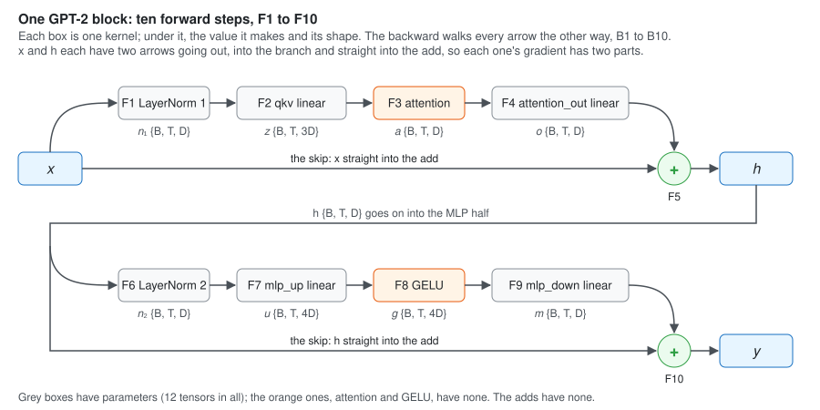

**What this is.** Every piece of a GPT-2 block now has its own kernel in my GPT-2 trainer [1], and its
own note: [LayerNorm](/posts/layer-norm-backward/) [2], [the linear layer](/posts/linear-backward/) [3],
[GELU](/posts/gelu-backward/) [4], [attention](/posts/attention-backward/) [5] and
[the residual add](/posts/residual-backward/) [6]. This note puts them together into one **block**, the
unit GPT-2 small stacks 12 times. Nothing in it is a new kernel. What is new is the joining: which value
goes where, which gradients add up, which numbers the block owns, and which ones it has to keep.

The block is written as ten forward steps, F1 to F10 (Section 1). One rule joins them backward: a value
used in two places gets the sum of two gradients (Section 2). With it, the ten backward steps, B1 to
B10, follow from the notes before (Section 3). Then the block's parameters: what they are, how many, in
what order and with what starting values (Section 4); its memory: what is kept from the forward to the
backward and what lives for one call only (Section 5); and its work (Section 6). Every number is for
GPT-2 small, and every one was worked out by hand and again in a script.

**Sources.** The block is GPT-2's [7]: a LayerNorm at the input of each half, and the residual layers'
weights scaled down at the start. The starting values 0.02 are from GPT-1 [8]. The code follows
llm.c's `train_gpt2.cu` [9].

* TOC
{:toc}

## 1. The forward pass

### 1.1 What a block does: two halves, each added onto the row

A block takes a tensor $$x$$ of shape `{B, T, D}`: $$B$$ sequences of $$T$$ tokens, each token a row of
$$D$$ numbers. It does two things to it, one after the other, and each time it **adds** what it computed
onto what it was given:

$$
h = x + \text{Attention-half}(x) \qquad\qquad y = h + \text{MLP-half}(h)
$$

- **The attention half** lets each token take in the tokens before it.
- **The MLP half** works on each token alone, its 768 numbers widened to 3072 and brought back.

Each half starts with a LayerNorm and ends with a linear layer. The add is the
[residual add](/posts/residual-backward/) [6]: the row goes around the half unchanged, and the half
only adds a correction onto it. GPT-2 puts the LayerNorm *inside* the half, at its input [7], so the
row that goes around is never normalized: what goes around is exactly $$x$$, and then exactly $$h$$.

### 1.2 The names

| symbol | code name | meaning | shape | GPT-2 small |
|---|---|---|---|---|
| $$B$$ | `batch_size` | sequences in one step | — | 4 |
| $$T$$ | `seq_len` | tokens in each sequence | — | 1024 |
| $$D$$ | `embed_dim` | numbers in each token's row | — | 768 |
| $$N_H$$ | `num_heads` | attention heads | — | 12 |
| $$H$$ | head size | numbers per head, $$D / N_H$$ | — | 64 |
| $$x$$ | `input` | the block's input | `{B, T, D}` | `{4, 1024, 768}` |
| $$n_1$$ | `ln1_output` | LayerNorm 1 of $$x$$ | `{B, T, D}` | `{4, 1024, 768}` |
| $$z$$ | `qkv` | query, key and value side by side | `{B, T, 3D}` | `{4, 1024, 2304}` |
| $$a$$ | `attention_output` | attention's output, the 12 heads joined | `{B, T, D}` | `{4, 1024, 768}` |
| $$o$$ | `branch_output` | the attention half's output | `{B, T, D}` | `{4, 1024, 768}` |
| $$h$$ | `residual2` | $$x + o$$, the row between the halves | `{B, T, D}` | `{4, 1024, 768}` |
| $$n_2$$ | `ln2_output` | LayerNorm 2 of $$h$$ | `{B, T, D}` | `{4, 1024, 768}` |
| $$u$$ | `mlp_up_output` | the widened row | `{B, T, 4D}` | `{4, 1024, 3072}` |
| $$g$$ | `gelu_output` | GELU of $$u$$ | `{B, T, 4D}` | `{4, 1024, 3072}` |
| $$m$$ | `branch_output` | the MLP half's output | `{B, T, D}` | `{4, 1024, 768}` |
| $$y$$ | `output` | $$h + m$$, the block's output | `{B, T, D}` | `{4, 1024, 768}` |
| $$L$$ | — | the loss: one number, how wrong the model is | 1 | 1 |
| $$dv$$ | `..._grad` | short for $$\partial L / \partial v$$, for any value $$v$$; same shape as $$v$$ | — | — |
| $$\overleftarrow{f}(dv)$$ | `..._backward` | the backward of step $$f$$: from the gradient of its output, the gradient of its input | — | — |

*Table 1. The sizes, then the values in the order the forward makes them. $$o$$ and $$m$$ have the same
code name: they are made at different times and never needed together (Section 5.2). The 12 parameters
have a table of their own, Table 6.*

### 1.3 Ten steps

Each step is one kernel launch. A linear layer is written the way [the linear note](/posts/linear-backward/)
[3] writes it: $$v = w\, W^\top + b$$, with $$W$$ of shape `{out, in}` and the $$B \times T = 4096$$
rows of $$w$$ handled at once.

| step | what it computes | kernel | output, GPT-2 small |
|---|---|---|---|
| F1 | $$n_1 = \mathrm{LN}_1(x)$$ | `layer_norm_forward` | `{4, 1024, 768}` |
| F2 | $$z = n_1 W_\text{qkv}^\top + b_\text{qkv}$$ | `linear_forward` | `{4, 1024, 2304}` |
| F3 | $$a = \mathrm{Attention}(z)$$ | `attention_forward` | `{4, 1024, 768}` |
| F4 | $$o = a\, W_\text{out}^\top + b_\text{out}$$ | `linear_forward` | `{4, 1024, 768}` |
| F5 | $$h = x + o$$ | `residual_forward` | `{4, 1024, 768}` |
| F6 | $$n_2 = \mathrm{LN}_2(h)$$ | `layer_norm_forward` | `{4, 1024, 768}` |
| F7 | $$u = n_2 W_\text{up}^\top + b_\text{up}$$ | `linear_forward` | `{4, 1024, 3072}` |
| F8 | $$g = \mathrm{GELU}(u)$$ | `gelu_forward` | `{4, 1024, 3072}` |
| F9 | $$m = g\, W_\text{down}^\top + b_\text{down}$$ | `linear_forward` | `{4, 1024, 768}` |
| F10 | $$y = h + m$$ | `residual_forward` | `{4, 1024, 768}` |

*Table 2. F1 to F5 are the attention half, F6 to F10 the MLP half: the same shape twice, LayerNorm,
then the half's own work, then a linear back to $$D$$, then the add. Inside F3, the attention note's six
steps [5] split $$z$$ into 12 heads of query, key and value, and join the 12 heads' outputs back.*

### 1.4 Where each value is used


*Figure 1. Each arrow is one use of a value. The backward walks the same arrows the other way.*

Counting the arrows that leave each value:

| value | used by | uses |
|---|---|---|
| $$x$$ | F1 (LayerNorm 1) and F5 (the add) | **2** |
| $$n_1, z, a, o$$ | F2, F3, F4, F5 | 1 each |
| $$h$$ | F6 (LayerNorm 2) and F10 (the add) | **2** |
| $$n_2, u, g, m$$ | F7, F8, F9, F10 | 1 each |
| $$y$$ | the next block, or the final LayerNorm | 1 |

*Table 3. Only $$x$$ and $$h$$ are used twice, and both times it is the add's skip that makes the
second use. Everything else is a straight chain.*

## 2. One rule: a value used twice gets two gradients, added

A straight chain needs only the chain rule: $$dv = \overleftarrow{f}(dw)$$ when $$w = f(v)$$. The block
also has two values with two uses each, and they need one more rule.

Take $$h$$. It reaches the loss along two roads: through LayerNorm 2 and the MLP into $$m$$, and straight
into the add. So $$L$$ depends on $$h$$ twice, once through each:

$$
y = h + m(h), \qquad m(h) = \mathrm{MLP}\big(\mathrm{LN}_2(h)\big)
$$

Move one number of $$h$$, $$h_k$$, by a small $$\varepsilon$$, and hold every parameter still. $$y$$ moves
for two reasons: the first $$h$$ moved by $$\varepsilon$$, and $$m$$ moved because its input did.
To first order, the two moves add, and so do the moves of the loss:

$$
\Delta L \approx \underbrace{\frac{\partial L}{\partial y_k}\,\varepsilon}_{\text{the skip}}
\;+\; \underbrace{\sum_j \frac{\partial L}{\partial m_j}\,\frac{\partial m_j}{\partial h_k}\,\varepsilon}_{\text{through the MLP}}
$$

Divide by $$\varepsilon$$:

$$
\boxed{\;dh = \underbrace{dy}_{\text{the skip}} + \underbrace{\overleftarrow{\mathrm{LN}_2}\big(dn_2\big)}_{\text{through the MLP half}}\;}
$$

with $$dn_2$$ what the MLP's backward sends back to LayerNorm 2's output. The same holds for $$x$$, with
$$dh$$ in the place of $$dy$$. This is the multivariable chain rule: **a value's gradient is the sum, over
its uses, of what each use sends back.** The residual note derives it for one add in full [6]; here it
is used twice, once per half.

## 3. The backward pass: B1 to B10

$$dy$$ is given: the next block sends it back. The job is to find $$dx$$, to send on to the block before,
and the gradient of each of the 12 parameters. The steps walk Table 2 from the bottom up, and each one
is a step whose backward has its own note.

### 3.1 The MLP half: B1 to B5

**B1, the add F10.** $$y = h + m$$ has slope 1 for both, so both get $$dy$$ unchanged [6]:

$$
dm = dy \qquad\qquad dh^{(1)} = dy
$$

$$dh^{(1)}$$ is only the first part of $$dh$$, the skip's. The second part comes in B5.

**B2, the linear F9.** The three products of the linear note [3], with $$g$$ the input that F9 read:

$$
dg = dm\, W_\text{down} \qquad dW_\text{down} \mathrel{+}= dm^\top g \qquad db_\text{down} \mathrel{+}= dm^\top \mathbf{1}
$$

**B3, GELU F8.** Each number on its own, by GELU's slope at the $$u$$ that F8 read [4]:

$$
du = dg \odot \mathrm{GELU}'(u)
$$

**B4, the linear F7.** The same three products:

$$
dn_2 = du\, W_\text{up} \qquad dW_\text{up} \mathrel{+}= du^\top n_2 \qquad db_\text{up} \mathrel{+}= du^\top \mathbf{1}
$$

**B5, LayerNorm F6, and the second part of $$dh$$.** LayerNorm's backward [2] needs $$h$$ and the
mean and rstd that F6 found. It gives the second part, and Section 2's rule adds it onto the first:

$$
dh = dh^{(1)} + \overleftarrow{\mathrm{LN}_2}(dn_2) \qquad d\gamma_2 \mathrel{+}= \textstyle\sum_\text{rows} dn_2 \odot \hat{h} \qquad d\beta_2 \mathrel{+}= \textstyle\sum_\text{rows} dn_2
$$

with $$\hat{h}$$ the normalized $$h$$, and $$\gamma_2, \beta_2$$ LayerNorm 2's weight and bias.

### 3.2 The attention half: B6 to B10

The same five moves, with $$dh$$ in the place of $$dy$$:

**B6, the add F5.** $$do = dh$$ and $$dx^{(1)} = dh$$.

**B7, the linear F4.** $$da = do\, W_\text{out}$$, $$dW_\text{out} \mathrel{+}= do^\top a$$,
$$db_\text{out} \mathrel{+}= do^\top \mathbf{1}$$.

**B8, attention F3.** The attention note's nine steps [5], from the queries, keys, values and weights
that F3 kept: $$dz = \overleftarrow{\mathrm{Attention}}(da)$$. Attention has no parameters.

**B9, the linear F2.** $$dn_1 = dz\, W_\text{qkv}$$, $$dW_\text{qkv} \mathrel{+}= dz^\top n_1$$,
$$db_\text{qkv} \mathrel{+}= dz^\top \mathbf{1}$$.

**B10, LayerNorm F1, and the second part of $$dx$$.**
$$dx = dx^{(1)} + \overleftarrow{\mathrm{LN}_1}(dn_1)$$, and $$d\gamma_1, d\beta_1$$ as in B5.

### 3.3 All ten steps

| step | walks back | kernel | writes `=` | adds `+=` |
|---|---|---|---|---|
| B1 | F10 | `residual_backward` | $$dm$$, $$dh$$ (its first part) | — |
| B2 | F9 | `linear_backward` | $$dg$$ | $$dW_\text{down}, db_\text{down}$$ |
| B3 | F8 | `gelu_backward` | $$du$$ | — |
| B4 | F7 | `linear_backward` | $$dn_2$$ | $$dW_\text{up}, db_\text{up}$$ |
| B5 | F6 | `layer_norm_backward` | — | $$dh$$ (its second part), $$d\gamma_2, d\beta_2$$ |
| B6 | F5 | `residual_backward` | $$do$$, $$dx$$ (its first part) | — |
| B7 | F4 | `linear_backward` | $$da$$ | $$dW_\text{out}, db_\text{out}$$ |
| B8 | F3 | `attention_backward` | $$dz$$ | — |
| B9 | F2 | `linear_backward` | $$dn_1$$ | $$dW_\text{qkv}, db_\text{qkv}$$ |
| B10 | F1 | `layer_norm_backward` | — | $$dx$$ (its second part), $$d\gamma_1, d\beta_1$$ |

*Table 4. Ten launches, the forward's ten in reverse. The two values used twice, $$h$$ and $$x$$, are
the two that are first written and later added onto: the add writes the skip's part, and LayerNorm's
backward adds the branch's part. That is why `layer_norm_backward` adds onto its input gradient instead
of writing it.*

### 3.4 Why the parameter gradients are added onto

Every parameter gradient in Table 4 is `+=`, though each parameter is used only once in the block. The
reason is outside the block. A training step can be bigger than what fits on the GPU at once: 8
batches of 4 sequences, say, run one after another, with the loss the sum of their losses. The
gradient of a sum is the sum of the gradients:

$$
L = L^{(1)} + L^{(2)} + \cdots + L^{(8)} \quad\Longrightarrow\quad dW = dW^{(1)} + dW^{(2)} + \cdots + dW^{(8)}
$$

So each backward adds its batch's part onto what the batches before left, and the gradients are set to
0 once, at the start of the step. $$dx$$ is different: it belongs to one batch's one pass, and B6
writes it fresh each time.

## 4. The parameters

### 4.1 Twelve tensors

| tensor | symbol | shape | values, $$D = 768$$ |
|---|---|---|---:|
| `qkv_weight` | $$W_\text{qkv}$$ | `{3D, D}` | 1,769,472 |
| `attention_out_weight` | $$W_\text{out}$$ | `{D, D}` | 589,824 |
| `mlp_up_weight` | $$W_\text{up}$$ | `{4D, D}` | 2,359,296 |
| `mlp_down_weight` | $$W_\text{down}$$ | `{D, 4D}` | 2,359,296 |
| *the 4 matrices* | | $$(3 + 1 + 4 + 4)\, D^2 = 12 D^2$$ | **7,077,888** |
| `ln1_weight`, `ln1_bias` | $$\gamma_1, \beta_1$$ | `{D}` each | 1,536 |
| `qkv_bias` | $$b_\text{qkv}$$ | `{3D}` | 2,304 |
| `attention_out_bias` | $$b_\text{out}$$ | `{D}` | 768 |
| `ln2_weight`, `ln2_bias` | $$\gamma_2, \beta_2$$ | `{D}` each | 1,536 |
| `mlp_up_bias` | $$b_\text{up}$$ | `{4D}` | 3,072 |
| `mlp_down_bias` | $$b_\text{down}$$ | `{D}` | 768 |
| *the 8 vectors* | | $$(2 + 3 + 1 + 2 + 4 + 1)\, D = 13 D$$ | **9,984** |
| **one block** | | $$12 D^2 + 13 D$$ | **7,087,872** |

*Table 5. The 12 tensors in the order the code keeps them, matrices first. The matrices are 99.86% of
the block: a block's size grows as $$D^2$$, and the vectors hardly count.*

### 4.2 The whole model

GPT-2 small is 12 blocks, plus the token embedding `wte` (one row for each of the 50,257 tokens), the
position embedding `wpe` (one row for each of the 1024 positions) and a final LayerNorm. The output
layer that turns rows back into 50,257 scores reuses `wte`, so it adds nothing:

| part | count | values |
|---|---|---:|
| 12 blocks | $$12 \times 7{,}087{,}872$$ | 85,054,464 |
| `wte` | $$50{,}257 \times 768$$ | 38,597,376 |
| `wpe` | $$1024 \times 768$$ | 786,432 |
| final LayerNorm | $$2 \times 768$$ | 1,536 |
| **GPT-2 small** | | **124,439,808** |

*Table 6. The "124M" of GPT-2 small, to the last value. In float, 498 MB; the optimizer keeps two more
numbers per value, and training needs a gradient for each, so four times that.*

### 4.3 Matrices first

AdamW shrinks the matrices a little at every step, **weight decay**, and leaves the biases and
LayerNorm weights alone. My AdamW kernel runs over all 124,439,808 values in one launch, and it tells
the two kinds apart by position: the first `decayed_count` values are decayed, the rest are not. So the
buffer that holds every parameter puts every matrix of the model first, for example:

```
params   [ wte | wpe | block 0's 4 matrices | ... | block 11's 4 matrices | block 0's 8 vectors | ... | ln_f ]
                                                                          ↑ decayed_count
```

A block does not own its memory. It holds 12 **views** into that buffer, 4 into the first part and 8
into the second, and a second set of 12 views into the gradients' buffer, laid out the same way. That
is why the block's own order is matrices first: the model can hand it its 12 views in the order they
sit in the buffer.

### 4.4 The starting values

| tensors | starting value |
|---|---|
| $$W_\text{qkv}, W_\text{up}$$ | random, mean 0, standard deviation 0.02 [8] |
| $$W_\text{out}, W_\text{down}$$ | random, mean 0, standard deviation $$0.02 / \sqrt{2 \times 12} = 0.0040825$$ [7] |
| the 6 biases | 0 |
| $$\gamma_1, \gamma_2$$ | 1 |
| $$\beta_1, \beta_2$$ | 0 |

*Table 7. With $$\gamma = 1$$ and $$\beta = 0$$, each LayerNorm starts as a plain normalize: every row
comes out with mean 0 and variance 1.*

**Why 0.02.** A matrix must start random: if all its rows were equal, every output would be equal, get
the same gradient and stay equal, so the layer would act as one output copied. How random comes from
the variance of a sum. One output of F2 is $$z_j = \sum_{i=1}^{D} n_{1,i}\, W_{j,i}$$, a sum of 768
products. With $$n_1$$ of variance 1 (LayerNorm's output) and weights of variance $$0.02^2$$, all
independent, the variances add:

$$
\mathrm{Var}(z_j) = D \cdot 1 \cdot 0.02^2 = 768 \times 0.0004 = 0.3072 \qquad \text{standard deviation } 0.554
$$

Numbers of the same size as the input's: not so big that the softmax picks one token outright, not so
small that every weight is the same.

**Why the two output layers start smaller.** They make $$o$$ and $$m$$, the two numbers each block adds
onto the row. After 12 blocks the row is the first one plus 24 of them:

$$
y_{12} = x_1 + o_1 + m_1 + o_2 + m_2 + \cdots + o_{12} + m_{12}
$$

24 independent parts of variance $$\sigma^2$$ add up to variance $$24\, \sigma^2$$, so a spread
$$\sqrt{24} = 4.90$$ times that of one. Starting their weights $$\sqrt{24}$$ times smaller makes the sum
of all 24 as spread as one part would be with 0.02. For one $$o$$, if $$a$$ has variance 0.3072 (as $$z$$
does; attention averages rows of $$z$$, which can only shrink it):

| | weights' std | $$\mathrm{Var}(o_j) = D \cdot 0.3072 \cdot \mathrm{std}^2$$ | std of $$o$$ |
|---|---|---:|---:|
| like the others | 0.02 | 0.0944 | 0.307 |
| GPT-2's | 0.0040825 | 0.00393 | 0.063 |
| 24 parts of GPT-2's, added | | $$24 \times 0.00393 = 0.0944$$ | 0.307 |

*Table 8. The last row equals the first: 24 small parts add up to one ordinary one. Small output layers
also make each half start close to "add nothing", which is where the gradient passes through best [6].*

## 5. Memory: what is kept, and for how long

The backward reads values the forward made: B2 reads $$g$$, B3 reads $$u$$, and so on. Between F of
block 0 and B of block 0, the other 11 blocks run their forward and backward. So every value a
backward step reads must be kept, **one copy per block**. Everything else is needed only inside one
call, and **one copy serves all 12 blocks**, since they run one at a time.

Sizes below are for $$B = 4$$, $$T = 1024$$, $$D = 768$$, $$N_H = 12$$. One `{B, T, D}` tensor is
$$4 \times 1024 \times 768 = 3{,}145{,}728$$ values, 12.6 MB in float.

### 5.1 Kept for the backward: one per block

| value | code name | shape | values | read by |
|---|---|---|---:|---|
| $$n_1$$ | `ln1_output` | `{B, T, D}` | 3,145,728 | B9: $$dW_\text{qkv} = dz^\top n_1$$ |
| mean, rstd of $$x$$ | `ln1_mean`, `ln1_rstd` | `{B, T}` each | 8,192 | B10 |
| query, key, value | `query`, `key`, `value` | `{B, N_H, T, H}` each | 9,437,184 | B8 |
| attention weights | `attention_weights` | `{B, N_H, T, T}` | 50,331,648 | B8 |
| $$a$$ | `attention_output` | `{B, T, D}` | 3,145,728 | B7: $$dW_\text{out} = do^\top a$$ |
| $$h$$ | `residual2` | `{B, T, D}` | 3,145,728 | B5 |
| $$n_2$$ | `ln2_output` | `{B, T, D}` | 3,145,728 | B4: $$dW_\text{up} = du^\top n_2$$ |
| mean, rstd of $$h$$ | `ln2_mean`, `ln2_rstd` | `{B, T}` each | 8,192 | B5 |
| $$u$$ | `mlp_up_output` | `{B, T, 4D}` | 12,582,912 | B3: $$\mathrm{GELU}'(u)$$ |
| $$g$$ | `gelu_output` | `{B, T, 4D}` | 12,582,912 | B2: $$dW_\text{down} = dm^\top g$$ |
| **one block** | `BlockActivations` | | **97,533,952** | |

*Table 9. 390 MB a block in float, 4.68 GB for 12. The block's input $$x$$ is kept too (B10 reads it),
but by the model, as the previous block's output: one more `{B, T, D}` per block.*

One row stands out, and one value is missing:

- **The attention weights are 52% of the block.** They are the only value that grows as $$T^2$$: one
  weight for every pair of tokens, in every head. At $$T = 2048$$ they would be 201 million values, more
  than everything else in the block at $$T = 1024$$.
- **$$z$$ is not kept.** F3 splits it into query, key and value, and B8 reads those, never $$z$$. So
  $$z$$ lives for one call only, in the shared tensors of Section 5.2: 9,437,184 values a block that are
  not kept, 453 MB for 12 in float.

### 5.2 Used once: one for all 12 blocks

| values | code names | shape | values |
|---|---|---|---:|
| $$o$$ and $$m$$; attention's heads before they are joined | `branch_output`, `head_outputs` | `{B, T, D}` size, 2 | 6,291,456 |
| $$z$$, before F3 splits it into heads | `qkv` | `{B, T, 3D}` | 9,437,184 |
| $$dh$$, $$do$$ and $$dm$$, $$dn_1$$ and $$dn_2$$, $$da$$ | `residual2_grad`, `branch_output_grad`, `ln_output_grad`, `attention_output_grad` | `{B, T, D}`, 4 | 12,582,912 |
| $$dg, du$$ | `gelu_output_grad`, `mlp_up_output_grad` | `{B, T, 4D}`, 2 | 25,165,824 |
| $$dz$$ | `qkv_grad` | `{B, T, 3D}` | 9,437,184 |
| the heads', queries', keys', values' gradients | `head_outputs_grad`, `query_grad`, `key_grad`, `value_grad` | `{B, N_H, T, H}`, 4 | 12,582,912 |
| the attention weights' gradient | `weights_grad` | `{B, N_H, T, T}` | 50,331,648 |
| **all** | `BlockScratch` | | **125,829,120** |

*Table 10. 503 MB in float, once. A value used once can share its memory even inside one call: $$o$$
is used by F5 and then never again, so $$m$$ takes its place at F9; the two halves' $$dn$$ take turns
the same way.*

### 5.3 The totals

| | float | bfloat16 |
|---|---:|---:|
| kept, one block | 390 MB | 195 MB |
| kept, 12 blocks | 4.68 GB | 2.34 GB |
| used once, shared | 503 MB | 252 MB |
| used once, if each block had its own | 6.04 GB | 3.02 GB |

*Table 11. Sharing what is used once saves 5.5 GB in float, over a third of a T4's 16 GB. In
[bfloat16](/posts/half-and-bfloat16/) [10] every value is 2 bytes instead of 4, except the means and
rstds, which stay float.*

## 6. The work

Almost all of the work is matrix products, and a product of `{M, K}` by `{K, N}` costs $$2MKN$$
floating-point operations, a multiply and an add for each term. Per token, in one block's forward:

| products | per token | |
|---|---|---:|
| the four linears | $$2 \times (3 + 1 + 4 + 4) D^2 = 24 D^2$$ | 14,155,776 |
| attention: scores $$q k^\top$$ and weights times values | $$2 \times 2\, T D = 4 T D$$ | 3,145,728 |
| **one block, forward** | | **17,301,504** |

*Table 12. Attention's two products run on the whole $$T \times T$$ square, the masked half too. The
linears are 82% of the work at $$T = 1024$$.*

The backward of each product is two products of the same size: $$dx$$ and $$dW$$ for a linear [3],
and two for each of attention's two [5]. So a step is three times the forward:

$$
3 \times 17{,}301{,}504 \times 4096 \text{ tokens} = 212.6 \text{ GFLOP a block} \qquad \times 12 = 2.55 \text{ TFLOP}
$$

A T4 does at most 8.1 TFLOP a second in float, so the 12 blocks need at least 0.31 seconds a step. The
LayerNorms, GELU and the adds hardly count here: they do a few operations per value, and their time
goes into reading and writing memory, not into arithmetic.

## 7. Three checks

**Output layers of 0 make the block pass everything through.** Set $$W_\text{out}, b_\text{out},
W_\text{down}, b_\text{down}$$ to 0. Then $$o = 0$$ and $$m = 0$$ whatever comes in, so $$h = x$$ and
$$y = x$$. Backward: B2 gives $$dg = dm\, W_\text{down} = 0$$, so $$du$$, $$dn_2$$ and LayerNorm 2's
part are all 0, and $$dh = dy$$. The same in the attention half gives $$dx = dh = dy$$. The block passes
its input forward and its gradient back, both exactly. Only the two output layers get gradients:
$$dW_\text{down} = dy^\top g$$ and $$dW_\text{out} = dy^\top a$$, and their biases both get
$$dy^\top \mathbf{1}$$, the column sums of $$dy$$, the same numbers twice. Every other gradient is 0.

**Two backwards double the parameter gradients.** Run B1 to B10 twice with the same $$dy$$. The `+=`
steps of Table 4 add the same numbers again, so all 12 gradients double; $$dx$$ is written fresh and
comes out the same both times.

**The counts agree.** Table 5 gives $$12 D^2 + 13 D$$ per block; with the embeddings, Table 6 gives
124,439,808, the size of GPT-2 small.

## 8. What it gives the code

The forward is Table 2, one line a step (`p` the parameters, `a` the kept values, `s` the scratch of
Section 5.2):

```cpp
layer_norm_forward(a.ln1_output, a.ln1_mean, a.ln1_rstd, input, p.ln1_weight, p.ln1_bias);         // F1
linear_forward(s.qkv, a.ln1_output, p.qkv_weight, p.qkv_bias);                                    // F2
attention_forward(a.attention_output, a.query, a.key, a.value, a.attention_weights,               // F3
                  s.head_outputs, s.qkv);
linear_forward(s.branch_output, a.attention_output, p.attention_out_weight, p.attention_out_bias); // F4
residual_forward(a.residual2, input, s.branch_output);                                             // F5
layer_norm_forward(a.ln2_output, a.ln2_mean, a.ln2_rstd, a.residual2, p.ln2_weight, p.ln2_bias);   // F6
linear_forward(a.mlp_up_output, a.ln2_output, p.mlp_up_weight, p.mlp_up_bias);                     // F7
gelu_forward(a.gelu_output, a.mlp_up_output);                                                      // F8
linear_forward(s.branch_output, a.gelu_output, p.mlp_down_weight, p.mlp_down_bias);                // F9
residual_forward(output, a.residual2, s.branch_output);                                            // F10
```

The backward is Table 4, one line a step, the same kernels' `_backward`. The three groups of tensors
are three structs, one for each lifetime:

| struct | holds | how many |
|---|---|---|
| `BlockParams` | the 12 parameters (Table 5), or their 12 gradients: views into the model's buffers | 2 per block |
| `BlockActivations` | what the backward reads (Table 9) | 1 per block |
| `BlockScratch` | what lives for one call (Table 10) | 1 for all 12 |

*Table 13. The block owns none of its parameters' memory and only its activations; the model owns the
rest.*

## 9. What to remember

1. **A block is two halves of the same shape.** LayerNorm, the half's own work, a linear back to $$D$$,
   an add: F1 to F5, then F6 to F10.
2. **One new rule joins the kernels backward.** A value used twice gets the sum of what both uses send
   back. Only $$x$$ and $$h$$ are used twice, so only their gradients are written once and added onto
   once.
3. **12 tensors, $$12 D^2 + 13 D$$ values.** 7,087,872 a block, matrices first so weight decay can tell
   them apart by position; 124,439,808 for GPT-2 small.
4. **Small output layers at the start.** $$0.02 / \sqrt{24}$$, so 24 additions to the row add up to
   the size of one.
5. **Two lifetimes.** What the backward reads is kept per block, 390 MB in float, half of it the
   attention weights; what is used once is shared by all 12 blocks.

## References

1. D. B. Song. *gpt2-small*, branch `c-cuda-trainer`: GPT-2 small pre-training in C and CUDA.
   [github.com/ducbachsong/gpt2-small](https://github.com/ducbachsong/gpt2-small/tree/c-cuda-trainer)
2. D. B. Song. *LayerNorm backward, broken down and rebuilt: nine chain-rule steps and one formula.* 2026.
   [/posts/layer-norm-backward/](/posts/layer-norm-backward/)
3. D. B. Song. *Linear backward, broken down and rebuilt: three chain-rule steps and three matrix
   products.* 2026. [/posts/linear-backward/](/posts/linear-backward/)
4. D. B. Song. *GELU backward, broken down and rebuilt: seven chain-rule steps and one slope.* 2026.
   [/posts/gelu-backward/](/posts/gelu-backward/)
5. D. B. Song. *Attention backward, broken down and rebuilt: nine chain-rule steps, a softmax over a
   whole row and four matrix products.* 2026. [/posts/attention-backward/](/posts/attention-backward/)
6. D. B. Song. *Residual add backward, broken down and rebuilt: one plus sign and a gradient that passes
   through.* 2026. [/posts/residual-backward/](/posts/residual-backward/)
7. A. Radford, J. Wu, R. Child, D. Luan, D. Amodei, I. Sutskever. *Language Models are Unsupervised
   Multitask Learners.* 2019. Section 2.3: LayerNorm moved to the input of each sub-block, and the
   weights of residual layers scaled by $$1/\sqrt{N}$$ at the start, $$N$$ the number of residual layers.
   [openai.com](https://cdn.openai.com/better-language-models/language_models_are_unsupervised_multitask_learners.pdf)
8. A. Radford, K. Narasimhan, T. Salimans, I. Sutskever. *Improving Language Understanding by
   Generative Pre-Training.* 2018. Section 4.1: weights from $$N(0, 0.02)$$.
   [openai.com](https://cdn.openai.com/research-covers/language-unsupervised/language_understanding_paper.pdf)
9. A. Karpathy. *llm.c*, `train_gpt2.cu`: the block's kernels in this order, the activations kept per
   layer, and the starting values. [github.com/karpathy/llm.c](https://github.com/karpathy/llm.c/blob/master/train_gpt2.cu)
10. D. B. Song. *Half and bfloat16: two ways to fit a float into 16 bits.* 2026.
    [/posts/half-and-bfloat16/](/posts/half-and-bfloat16/)
