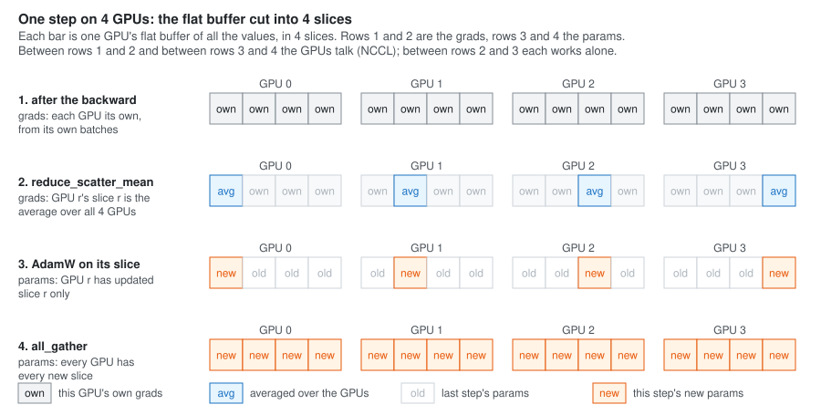

**What this is.** My GPT-2 trainer [1] has so far run on one GPU. The full run will be on eight H100s,
so it needs a way for eight GPUs to train **one** model. The way used here is the simplest one that
works well at this size: every GPU holds the whole model, reads different batches, and then the GPUs
agree on one update. The code is one small file, `llmc/distributed.cuh`, with five functions that talk
between GPUs. This note is about the math behind them: what the GPUs must agree on, why that is the
right thing, and how the work of the update can be split eight ways without changing its result.

The plan: the names (Section 1); why the step uses the **average** of the eight gradients (Section 2);
why AdamW can be cut into slices, one for each GPU (Section 3); the three moves that do it, a
reduce-scatter (Section 4), the norm from the slices (Section 5) and an all-gather (Section 6); what
they cost in bytes and save in memory (Section 7); and how the eight processes find each other at the
start (Section 8).

**Sources.** The three moves are nanochat's [7]. Splitting the optimizer's state is the first stage of
ZeRO [4]. The two collectives are NVIDIA's NCCL [6], and the ring that shows what they cost is from
Patarasuk and Yuan [5].

* TOC
{:toc}

## 1. The setup: one process per GPU

Eight GPUs run eight copies of the same program, called **processes**. Each one has a number, its
**rank**, and they all know how many there are, the **world size**. Each process uses one GPU, holds all
of GPT-2 small, and reads its own batches.

| symbol | code name | meaning | GPT-2 small on 8 H100s |
|---|---|---|---|
| $$W$$ | `world_size` | how many processes, one per GPU | 8 |
| $$r$$ | `rank` | this process: $$0, 1, \ldots, W - 1$$ | 0 .. 7 |
| $$M$$ | `micro_batches` | batches each GPU runs one after another in one step | 8 |
| $$B, T$$ | `batch_size`, `seq_len` | one batch: $$B$$ rows of $$T$$ tokens | 4, 1024 |
| $$P$$ | `all_params().numel()` | all the parameter values, in one flat buffer | 124,475,904 |
| $$S$$ | `slice_size` | one GPU's slice: $$P / W$$ | 15,559,488 |
| $$w$$ | | any one parameter value | |
| $$L_r$$ | | the loss of rank $$r$$'s batches in this step | |
| $$L$$ | | the loss of the whole step, all ranks' batches | |
| $$g^{(r)}$$ | `all_grads()` on rank $$r$$ | rank $$r$$'s gradients, $$\partial L_r / \partial w$$ for every $$w$$ | $$P$$ values |

*Table 1. $$P$$ is GPT-2 small's 124,439,808 [2] plus 36,096: the token table is padded from 50,257
rows to 50,304, as llm.c does [8], so that $$P$$ splits into 8 slices that are each a multiple of 4,
for the float4 loads of the AdamW kernel.*

One step reads $$W \times M \times B \times T = 8 \times 8 \times 4 \times 1024 = 262{,}144$$ tokens,
32,768 on each GPU. The batches never overlap: in each round, rank $$r$$ takes batch $$r$$, and the
round moves $$W$$ batches on.


*Figure 1. One step, drawn with 4 GPUs so the slices are easy to see. The GPUs talk twice, between
rows 1 and 2 and between rows 3 and 4. Each part of this note explains one row.*

## 2. Why the step uses the average of the gradients

### 2.1 The loss of a step is the average of the ranks' losses

The model's loss is the mean of the loss at every token: how far off the model is at predicting the
next token, averaged. One GPU alone with $$M$$ batches takes the mean over $$M B T$$ tokens. Eight
GPUs together should take the mean over all $$W M B T$$ tokens they read, as if one huge GPU had read
them all:

$$
L = \frac{1}{W M B T} \sum_{\text{all } W M B T \text{ tokens}} \ell_\text{token}
$$

Split the sum by which rank read the token. Each rank's tokens are $$M B T$$ of the total, and its own
loss is the mean over them, $$L_r = \frac{1}{M B T} \sum_{\text{rank } r\text{'s tokens}} \ell_\text{token}$$:

$$
L = \frac{1}{W} \sum_{r=0}^{W-1} \underbrace{\frac{1}{M B T} \sum_{\text{rank } r\text{'s tokens}} \ell_\text{token}}_{L_r}
= \frac{1}{W} \big( L_0 + L_1 + \cdots + L_{W-1} \big)
$$

The first equal sign only moves $$\frac{1}{W M B T} = \frac{1}{W} \cdot \frac{1}{M B T}$$ around and
groups the terms; nothing is added or lost. **The loss of the step is the average of the eight ranks'
losses.**

### 2.2 Its gradient is the average of the ranks' gradients

Take one parameter value $$w$$. The full form of what we need is $$\partial L / \partial w$$, with $$L$$
from Section 2.1:

$$
\frac{\partial L}{\partial w} = \frac{\partial}{\partial w} \Big[ \frac{1}{W} \big( L_0 + L_1 + \cdots + L_{W-1} \big) \Big]
$$

Two rules give it:

- **A constant times something**: the derivative of $$c \cdot f$$ is $$c \cdot f'$$. Here $$c = 1/W$$,
  which does not depend on $$w$$.
- **A sum, term by term**: the derivative of $$f_0 + f_1 + \cdots$$ is $$f_0' + f_1' + \cdots$$.

So:

$$
\boxed{\;\frac{\partial L}{\partial w} = \frac{1}{W} \Big( \frac{\partial L_0}{\partial w} + \frac{\partial L_1}{\partial w} + \cdots + \frac{\partial L_{W-1}}{\partial w} \Big)\;}
\qquad\text{written short:}\qquad g = \frac{1}{W} \sum_{r} g^{(r)}
$$

Each $$\partial L_r / \partial w$$ is exactly what rank $$r$$'s backward gives on its own: it never
needs the other ranks' tokens. So each GPU can run its forward and backward alone, and only the
**average** at the end needs all of them.

**A tiny case, with numbers.** Two ranks, one parameter $$w$$, and two made-up losses:
$$L_0 = (w - 1)^2$$ and $$L_1 = (w - 5)^2$$. At $$w = 2$$:

| | $$L_r$$ at $$w = 2$$ | $$\partial L_r / \partial w = 2(w - a)$$ |
|---|---:|---:|
| rank 0, $$a = 1$$ | 1 | 2 |
| rank 1, $$a = 5$$ | 9 | −6 |
| $$L = \frac{1}{2}(L_0 + L_1)$$ | 5 | $$\frac{1}{2}(2 - 6) = -2$$ |

*Table 2. The average of the two slopes, 2 and −6, is −2.*

Check it by moving $$w$$ a little, to 2.001: $$L_0 = 1.002001$$ and $$L_1 = 8.994001$$, so
$$L = 4.998001$$. $$L$$ moved by $$-0.001999$$ for a move of $$0.001$$ in $$w$$: a slope of $$-1.999$$,
the −2 of the table, to first order.

### 2.3 In the code, half of the average is already done

The backward does not compute $$\partial \ell / \partial w$$ for each token and then average: it starts
from $$\partial L_r / \partial \ell_\text{token}$$ and carries it back. With
$$L_r = \frac{1}{M B T} \sum \ell_\text{token}$$, each term has the coefficient $$\frac{1}{M B T}$$, so
by the constant rule:

$$
\frac{\partial L_r}{\partial \ell_\text{token}} = \frac{1}{M B T} = \frac{1}{8 \times 4 \times 1024} = \frac{1}{32{,}768}
$$

That is what `gpt2_backward` writes into every token's loss gradient, and the $$M$$ backwards add their
parts onto the same gradients [2]. So after the $$M$$ micro-batches, rank $$r$$ holds $$g^{(r)}$$, the
gradient of its own mean. The last $$\frac{1}{W}$$ and the sum over ranks are what the GPUs have to do
together, in Section 4. In all, each token counts with weight $$\frac{1}{W M B T} = \frac{1}{262{,}144}$$.

### 2.4 One condition: every GPU must hold the same parameters

$$\partial L_r / \partial w$$ is a slope **at a point**: it depends on where $$w$$ is. The average of
Section 2.2 is the slope of $$L$$ only if every rank took its slope at the same $$w$$. So all eight GPUs
must hold the same parameters, exactly, at the start of every step. Section 6 shows why they do.

## 3. Why AdamW can be cut into slices

With the averaged gradient $$g$$ on every GPU, the simple way on would be for every GPU to run the same
AdamW step on all $$P$$ values. Each would get the same answer: eight GPUs doing the same work eight
times. Look at what AdamW [9] does to one value $$i$$, as the kernel does it:

$$
\begin{aligned}
g_i &\leftarrow c \cdot g_i && \text{clip} \\
p_i &\leftarrow p_i\,(1 - \eta \lambda) && \text{weight decay, matrices only} \\
m_i &\leftarrow \beta_1 m_i + (1 - \beta_1)\, g_i \\
v_i &\leftarrow \beta_2 v_i + (1 - \beta_2)\, g_i^2 \\
p_i &\leftarrow p_i - \frac{\eta}{1 - \beta_1^t} \cdot \frac{m_i}{\sqrt{v_i} / \sqrt{1 - \beta_2^t} + \epsilon}
\end{aligned}
$$

Every line reads and writes **only index $$i$$**: $$g_i, p_i, m_i, v_i$$. The other numbers are the same
for every value: the learning rate $$\eta$$, the weight decay $$\lambda$$, $$\beta_1, \beta_2,
\epsilon$$, the step count $$t$$, and the clip factor $$c$$. Nothing in value $$i$$'s update looks at
value $$j$$.

So the values can be shared out. Cut the flat buffer of $$P$$ values into $$W$$ slices of $$S$$, and
let rank $$r$$ update only slice $$r$$, values $$rS$$ to $$(r + 1)S - 1$$:

```
all params, flat   [ slice 0 | slice 1 | slice 2 | ... | slice 7 ]     15,559,488 values each
                     rank 0    rank 1    rank 2          rank 7
```

Each value gets exactly the update it would get on one GPU, as long as two things hold:

1. **Rank $$r$$ has the average $$g_i$$ for the values of its slice.** It needs no other $$g_i$$.
   Section 4.
2. **Every rank uses the same shared numbers.** $$\eta$$, $$\lambda$$, the $$\beta$$s, $$\epsilon$$ and
   $$t$$ are the same on every rank already: they come from the settings and the step number. The clip
   factor $$c$$ is the exception, because it depends on all the gradients. Section 5.

The weight-decay border, where the matrices end, may fall inside a slice. That changes nothing: the
kernel decides by the value's index, and the index of a value is the same whichever rank updates it.

What the cut saves: rank $$r$$ keeps AdamW's $$m$$ and $$v$$, and the float master copy of the params,
for its own slice only. That is ZeRO's first stage [4]: the optimizer's state is shared out, while the
model and its gradients stay whole on every GPU.

## 4. Reduce-scatter: the average, one slice each

### 4.1 What it computes

After the backward, rank $$q$$ holds its own $$g^{(q)}$$, all $$P$$ values. The reduce-scatter leaves
on each rank $$r$$ the average of the $$W$$ gradients, but only over slice $$r$$:

$$
\text{for } i \text{ in slice } r: \qquad g_i \leftarrow \frac{1}{W} \sum_{q=0}^{W-1} g_i^{(q)} \qquad \text{on rank } r
$$

That is Section 2.2's formula, done for the values rank $$r$$ updates and no others. "Reduce" is the
sum over ranks (NCCL's `ncclAvg` divides it by $$W$$ as well), and "scatter" is that each rank gets a
different part of the result.

**An example.** Two ranks and four values, so each slice holds two:

| | values 0, 1 (rank 0's slice) | values 2, 3 (rank 1's slice) |
|---|---|---|
| rank 0's grads, $$g^{(0)}$$ | 2, 4 | 6, 8 |
| rank 1's grads, $$g^{(1)}$$ | 4, 0 | 2, 2 |
| average, $$\frac{1}{2}(g^{(0)} + g^{(1)})$$ | **3, 2** | **4, 5** |

After it, each rank holds:

| | values 0, 1 | values 2, 3 |
|---|---|---|
| rank 0 | **3, 2**, averaged | 6, 8, its own, not used again |
| rank 1 | 4, 0, its own, not used again | **4, 5**, averaged |

*Table 3. Each rank gets the right average where it will update, and leaves the rest alone. Row 2 of
Figure 1.*

### 4.2 How the data moves: a ring

Why this costs no more than sending each value about once can be seen with one way of doing it, a
**ring** [5]. Put the ranks in a circle; each one sends only to the next. Cut every rank's gradients
into $$W$$ chunks, chunk $$c$$ being the values of slice $$c$$. In round $$k = 1, 2, \ldots, W - 1$$,
rank $$q$$ sends to rank $$q + 1$$ the running sum of chunk $$q - k$$ (counted round the circle), and
the rank that receives it adds its own part. With $$W = 3$$, writing $$a_c$$, $$b_c$$, $$e_c$$ for
ranks 0, 1 and 2's parts of chunk $$c$$:

| round | rank 0 sends to 1 | rank 1 sends to 2 | rank 2 sends to 0 | after it, rank 0 / 1 / 2 hold |
|---|---|---|---|---|
| 1 | its chunk 2: $$a_2$$ | its chunk 0: $$b_0$$ | its chunk 1: $$e_1$$ | $$e_1 + a_1$$ / $$a_2 + b_2$$ / $$b_0 + e_0$$ |
| 2 | chunk 1: $$e_1 + a_1$$ | chunk 2: $$a_2 + b_2$$ | chunk 0: $$b_0 + e_0$$ | $$a_0 + b_0 + e_0$$ / $$a_1 + b_1 + e_1$$ / $$a_2 + b_2 + e_2$$ |

*Table 4. After $$W - 1 = 2$$ rounds, rank $$r$$ holds the full sum of chunk $$r$$: its slice. Divide
by $$W$$ and it is the average.*

Every rank sent $$W - 1$$ chunks of $$S$$ values: $$(W - 1) S = \frac{W - 1}{W} P$$. No way of doing it
can send less. Rank $$q$$ holds $$(W - 1) S$$ values that belong to other ranks' slices, and every one
of them changes some average, so all of them must leave rank $$q$$ in some form. NCCL picks its own way
for the hardware it finds [6], but the count is the same floor.

### 4.3 In place

The code passes the gradients' own buffer as the input, and the place where slice $$r$$ starts as the
output, so the averaged slice lands where the optimizer reads it, and no second buffer is needed. NCCL
allows this exact overlap [6]: a reduce-scatter runs in place when the output is the input moved on by
$$r \times S$$ values. The start is counted in bytes, so the code multiplies by the size of one value:

$$
\text{start of slice } r = r \times S \times \text{bytes per value}
\qquad \text{rank 3, bfloat16:} \quad 3 \times 15{,}559{,}488 \times 2 = 93{,}356{,}928 \text{ bytes}
$$

## 5. The norm of all the gradients, from the norms of the slices

### 5.1 Why the clip needs every value

Gradient clipping scales every gradient by the same factor $$c$$ when the gradients are too big all
together:

$$
c = \min\Big(1,\; \frac{N_\text{max}}{\lVert g \rVert}\Big), \qquad \lVert g \rVert = \sqrt{g_0^2 + g_1^2 + \cdots + g_{P-1}^2}
$$

with $$N_\text{max}$$ the trainer's `max_norm`, 1.0 here. $$\lVert g \rVert$$ is a sum over all $$P$$ values, but after the
reduce-scatter each rank has the averaged values of its own slice only. So it can find the norm of its
slice, $$\lVert g_{[r]} \rVert$$, and nothing more.

### 5.2 Norms add through their squares

Square the norm and split the sum by slice. The terms are the same, only grouped:

$$
\lVert g \rVert^2 = \sum_{i=0}^{P-1} g_i^2
= \underbrace{\sum_{i \in \text{slice } 0} g_i^2}_{\lVert g_{[0]} \rVert^2}
+ \underbrace{\sum_{i \in \text{slice } 1} g_i^2}_{\lVert g_{[1]} \rVert^2}
+ \cdots
+ \underbrace{\sum_{i \in \text{slice } W-1} g_i^2}_{\lVert g_{[W-1]} \rVert^2}
$$

$$
\boxed{\;\lVert g \rVert = \sqrt{\lVert g_{[0]} \rVert^2 + \lVert g_{[1]} \rVert^2 + \cdots + \lVert g_{[W-1]} \rVert^2}\;}
$$

So each rank squares its slice's norm, the ranks **sum** the squares (an all-reduce of one number,
which leaves the sum on every rank), and each takes the square root. In the code that is two
one-thread kernels around one `ncclAllReduce`, and the number never leaves the GPU.

With the averaged slices of Table 3, $$(3, 2)$$ on rank 0 and $$(4, 5)$$ on rank 1:

| | slice | its norm | its norm, squared |
|---|---|---:|---:|
| rank 0 | 3, 2 | $$\sqrt{13} = 3.6056$$ | 13 |
| rank 1 | 4, 5 | $$\sqrt{41} = 6.4031$$ | 41 |
| all | 3, 2, 4, 5 | $$\sqrt{54} = 7.3485$$ | 54 |

*Table 5. The squares add: 13 + 41 = 54. The norms do not: 3.6056 + 6.4031 = 10.0087, not 7.3485.*

Adding the norms is always too big, unless all slices but one are 0: a straight line between two
points is never longer than going through a third (the triangle inequality). So the sum of norms
would clip too hard.

### 5.3 What goes wrong if each rank clips by its own slice

Suppose each rank skipped the all-reduce and clipped by its own slice's norm, with $$N_\text{max} = 1$$:

| | rank 0's $$c$$ | rank 1's $$c$$ | clipped $$g$$ | norm of the clipped $$g$$ |
|---|---:|---:|---|---:|
| right: one $$c$$ from $$\lVert g \rVert$$ | $$1 / 7.3485 = 0.13608$$ | 0.13608 | 0.4082, 0.2722, 0.5443, 0.6804 | 1.0000 |
| wrong: each its own $$c$$ | $$1 / 3.6056 = 0.27735$$ | $$1 / 6.4031 = 0.15617$$ | 0.8321, 0.5547, 0.6247, 0.7809 | 1.4142 |

*Table 6. The wrong one clips each slice to norm 1, so the whole is $$\sqrt{2}$$ long, not 1.*

The length is only half of the damage. Clipping is meant to shorten the gradient and keep its
**direction**: in $$g$$, value 2 is $$4/3 = 1.33$$ times value 0, and in the right row it still is,
$$0.5443 / 0.4082 = 1.33$$. In the wrong row it is $$0.6247 / 0.8321 = 0.75$$: rank 0's slice was
scaled up against rank 1's. The step would point somewhere the gradient does not, and how far off would
depend on where the slice borders fall.

## 6. All-gather, and why every GPU stays the same

After AdamW, rank $$r$$ has new values for slice $$r$$ and last step's values everywhere else (row 3
of Figure 1). The all-gather sends each rank's slice to every rank:

$$
\text{for every rank } q \text{ and every slice } r: \qquad p_{[r]} \text{ on rank } q \;\leftarrow\; p_{[r]} \text{ on rank } r
$$

Like the reduce-scatter, it runs in place, with each rank's input at its own slice, and every rank
receives the $$(W - 1) S$$ values it does not have.

Now Section 2.4's condition. Every GPU holds the same parameters at every step, by induction:

- **At the start**, every rank makes its starting values from the same seed, so they are equal.
- **If they are equal at a step's start**, every slice is updated by exactly one rank, with the same
  average gradient, the same $$c$$ and the same $$\eta$$ and $$t$$, and the all-gather then copies that
  one result to every rank. So they are equal at the next step's start.

Nothing ever "fixes up" a GPU that drifted: they cannot drift, because each value is computed in one
place only.

### 6.1 The two moves are one all-reduce, cut in half

An **all-reduce** leaves the whole average on every rank. The ring version of it [5] is exactly a
reduce-scatter followed by an all-gather. So the step here is an all-reduce with AdamW put in its
middle:

| | all-reduce, then AdamW on all | reduce-scatter, AdamW on a slice, all-gather |
|---|---|---|
| values each GPU sends | $$2 \cdot \frac{W - 1}{W} P$$ | $$\frac{W - 1}{W} P + \frac{W - 1}{W} P$$, the same |
| AdamW's work per GPU | $$P$$ values | $$S = P / W$$ values |
| AdamW's state per GPU | $$P$$ values of $$m, v$$ and master | $$S$$ values of each |

*Table 7. The same bytes, an eighth of the update's work and memory.*

## 7. What it costs, and what it saves

### 7.1 Bytes moved

In [bfloat16](/posts/half-and-bfloat16/) [3] the gradients and the parameters are 2 bytes a value, so
each collective moves, per GPU:

$$
\frac{W - 1}{W} \times P \times 2 \text{ bytes} = \frac{7}{8} \times 124{,}475{,}904 \times 2 = 217{,}832{,}832 \text{ bytes} = 217.8 \text{ MB}
$$

An H100's NVLink carries 450 GB/s each way [11], so one collective takes at least
$$217.8 \text{ MB} / 450 \text{ GB/s} = 0.48$$ ms, and the two about 1 ms. The norm's all-reduce and the
loss's average are one float each, and the time they take is the waiting, not the bytes.

### 7.2 Memory saved

Each value of the slice has three floats of optimizer state, 12 bytes: the float master copy, $$m$$ and
$$v$$.

| per GPU | on 1 GPU | on 8 GPUs |
|---|---:|---:|
| the model's params and grads, bfloat16, 4 bytes a value | 497.9 MB | 497.9 MB, whole on every GPU |
| master, $$m$$, $$v$$: 12 bytes a value of the slice | 1,493.7 MB | 186.7 MB |
| **all** | **1,991.6 MB** | **684.6 MB** |

*Table 8. 1.31 GB less on each GPU. A checkpoint holds the same 12 bytes a value, so each rank writes
a file of 187 MB.*

For GPT-2 small, an 80 GB H100 has room either way; most of its memory goes to the activations [2].
The saving matters more as models grow, since the optimizer's state is 12 bytes a value against the
model's 4.

## 8. Starting: eight processes find each other

The math above needs eight processes that know their rank and can reach each other. The launcher,
torchrun [10], starts eight copies of the program and tells each one who it is through three
environment variables:

| variable | means | GPU 0 .. 7 on one machine |
|---|---|---|
| `RANK` | this process, $$r$$ | 0 .. 7 |
| `LOCAL_RANK` | which GPU of this machine it uses | 0 .. 7, the same as `RANK` on one machine |
| `WORLD_SIZE` | how many processes, $$W$$ | 8 |

*Table 9. With none of them set, the program is rank 0 of 1, and every collective does nothing.*

To talk, NCCL needs every process to hold the same 128-byte **id**, made by rank 0. It holds where
rank 0 can be reached on the network. The processes share no memory, so rank 0 writes the id to a file,
and the others check for the file every 10 ms and read it.

A rank must never read the file while it is half written, so rank 0 writes it under another name and
renames it when it is whole. On Linux a rename within one folder is **atomic**: the file is either not
there or there with all 128 bytes.

| | rank 0 | rank 5 |
|---|---|---|
| 1 | writes all 128 bytes to `nccl_id.partial`, closes it | `nccl_id` is not there: waits 10 ms |
| 2 | renames it to `nccl_id` | |
| 3 | | opens `nccl_id`, reads all 128 bytes |

*Table 10. Without the rename, rank 5 could open the file between its creation and the write, and read
0 bytes or a broken id.*

Then every rank calls `ncclCommInitRank` with the id and its rank, which returns when all eight have
joined. llm.c can pass the id through a file in the same way [8].

## 9. What it gives the code

The step, as `train_gpt2.cu` runs it on every rank:

```cpp
for (int micro_batch = 0; micro_batch < c.micro_batches; micro_batch++) {   // Section 2.3: g^(r)
    train_loader.next_batch(token_ids, targets);
    gpt2_forward(...);
    gpt2_backward(...);
}
distributed.reduce_scatter_mean(optimizer.all_grads());   // Section 4: slice r averaged over the ranks
grad_norm.compute(grads_slice, optimizer.grad_norm());    // Section 5: the norm of slice r...
distributed.slice_norms_to_norm(optimizer.grad_norm());   // ...then of all, sqrt of the sum of squares
optimizer.step();                                         // Section 3: AdamW on slice r
distributed.all_gather(optimizer.all_params());           // Section 6: every slice to every rank
float loss = distributed.mean_of_cpu_value(loss_of_this_rank);   // the step's loss, Section 2.1, for the log
```

The five functions of `distributed.cuh`:

| function | NCCL call | what it computes | Section |
|---|---|---|---|
| `reduce_scatter_mean` | `ncclReduceScatter`, `ncclAvg` | $$\frac{1}{W} \sum_q g^{(q)}$$ over slice $$r$$, on rank $$r$$ | 4 |
| `slice_norms_to_norm` | `ncclAllReduce`, `ncclSum` | $$\sqrt{\sum_r \lVert g_{[r]} \rVert^2}$$ on every rank | 5 |
| `all_gather` | `ncclAllGather` | every slice onto every rank | 6 |
| `mean_of_cpu_value` | `ncclAllReduce`, `ncclAvg` | $$\frac{1}{W} \sum_r x_r$$ of one CPU number, such as the loss | 2.1 |
| `barrier` | `mean_of_cpu_value(0)` | nothing: it returns only once every rank has called it | |

*Table 11. Every rank must call them in the same order. A collective cannot finish until all ranks
have joined it, so a rank that skips one leaves the other seven waiting forever.*

## 10. Three checks

**One GPU is the old trainer.** With $$W = 1$$: the average of one gradient is itself, the one slice
is all $$P$$ values, $$\sqrt{\lVert g_{[0]} \rVert^2} = \lVert g \rVert$$, and the all-gather has
nothing to send. Every function returns at once, and the step is the one-GPU step.

**Eight GPUs are one GPU with eight times the batches.** By Section 2, eight GPUs with $$M = 8$$ take
the gradient of the mean over 262,144 tokens, and so does one GPU with $$M = 64$$ reading the same
tokens. The results agree up to rounding: the sums are added in a different order, and the average of
the bfloat16 gradients is rounded to bfloat16.

**The norm.** Table 5: the squares of the slices' norms, 13 and 41, add up to the square of the whole
norm, 54, the same as $$3^2 + 2^2 + 4^2 + 5^2$$ added up directly.

## 11. What to remember

1. **The step's loss is the average of the ranks' losses**, so its gradient is the average of the
   ranks' gradients: a constant times a sum, differentiated term by term.
2. **AdamW updates each value on its own**, so each GPU can update one slice, and keep $$m$$, $$v$$ and
   the master for that slice only: 186.7 MB on each GPU instead of 1,493.7 MB.
3. **Clipping is the one thing that needs all the values.** Norms add through their squares:
   $$\sqrt{13 + 41}$$, not $$\sqrt{13} + \sqrt{41}$$. Clipping by a slice's own norm would turn the
   step.
4. **Reduce-scatter, then all-gather, is an all-reduce cut in half**, with the update in the middle:
   the same 217.8 MB sent per GPU each, the floor for any way of doing it.
5. **The GPUs stay the same because each value is computed in one place**: the same seed at the start,
   one owner per slice, and the all-gather copying the owner's result to everyone.

## References

1. D. B. Song. *gpt2-small*, branch `c-cuda-trainer`: GPT-2 small pre-training in C and CUDA;
   `llmc/distributed.cuh`, `llmc/optimizer.cuh`, `train_gpt2.cu`.
   [github.com/ducbachsong/gpt2-small](https://github.com/ducbachsong/gpt2-small/tree/c-cuda-trainer)
2. D. B. Song. *One GPT-2 block: ten steps forward, ten steps back, and twelve parameter tensors.* 2026.
   Section 3.4: the micro-batches' gradients add up; Section 4.2: the 124,439,808 parameters; Section 5:
   the activations. [/posts/gpt2-block/](/posts/gpt2-block/)
3. D. B. Song. *Half and bfloat16: two ways to fit a float into 16 bits.* 2026.
   [/posts/half-and-bfloat16/](/posts/half-and-bfloat16/)
4. S. Rajbhandari, J. Rasley, O. Ruwase, Y. He. *ZeRO: Memory Optimizations Toward Training Trillion
   Parameter Models.* SC 2020. Stage 1: each GPU keeps the optimizer's state for its own part of the
   parameters. [arXiv:1910.02054](https://arxiv.org/abs/1910.02054)
5. P. Patarasuk, X. Yuan. *Bandwidth optimal all-reduce algorithms for clusters of workstations.*
   Journal of Parallel and Distributed Computing 69(2), 2009: the ring all-reduce as a reduce-scatter
   and an all-gather, each sending $$\frac{W - 1}{W}$$ of the data.
6. NVIDIA. *NCCL User Guide*: Collective Operations, and In-place Operations.
   [docs.nvidia.com/deeplearning/nccl](https://docs.nvidia.com/deeplearning/nccl/user-guide/docs/usage/collectives.html)
7. A. Karpathy. *nanochat*: its distributed AdamW, a reduce-scatter of the gradients, an update of each
   rank's part, and an all-gather of the parameters. [github.com/karpathy/nanochat](https://github.com/karpathy/nanochat)
8. A. Karpathy. *llm.c*, `train_gpt2.cu`: the token table padded to 50,304 rows, the optimizer's state
   split across GPUs, and NCCL's id passed through a file.
   [github.com/karpathy/llm.c](https://github.com/karpathy/llm.c/blob/master/train_gpt2.cu)
9. I. Loshchilov, F. Hutter. *Decoupled Weight Decay Regularization.* ICLR 2019: AdamW.
   [arXiv:1711.05101](https://arxiv.org/abs/1711.05101)
10. PyTorch. *torchrun (Elastic Launch)*: the environment variables `RANK`, `LOCAL_RANK` and `WORLD_SIZE`.
    [docs.pytorch.org](https://docs.pytorch.org/docs/stable/elastic/run.html)
11. NVIDIA. *H100 Tensor Core GPU* datasheet: NVLink 900 GB/s for the SXM board, 450 GB/s each way.
    [nvidia.com](https://www.nvidia.com/en-us/data-center/h100/)
